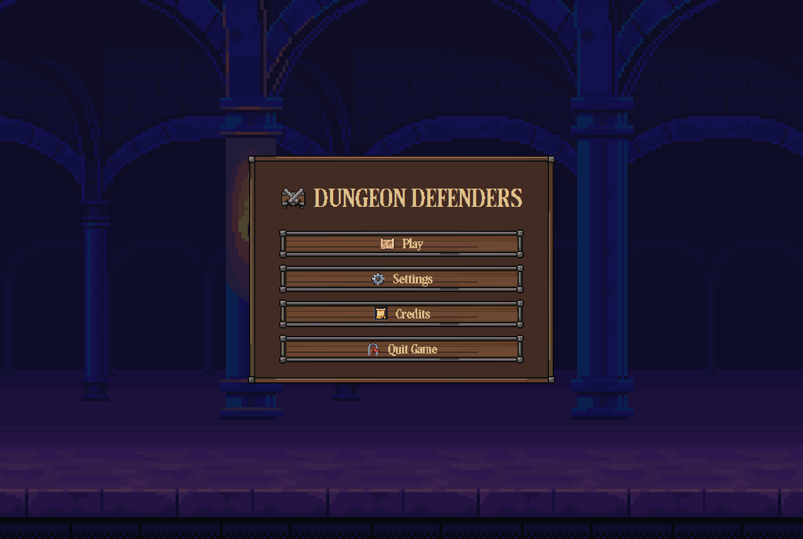
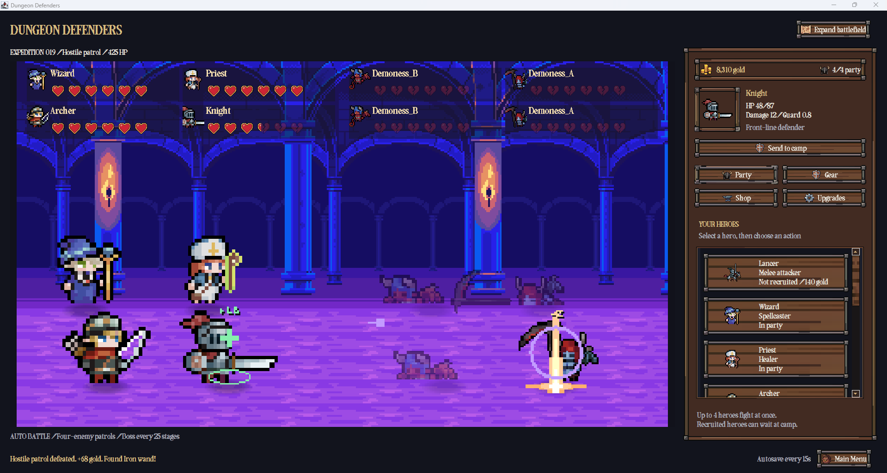
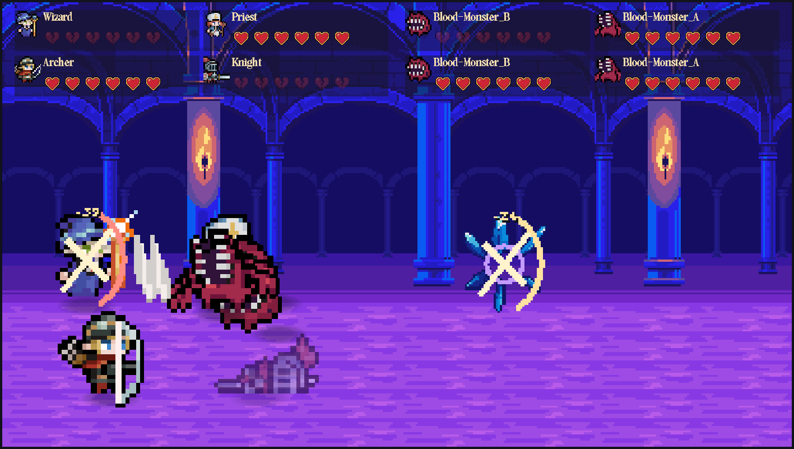
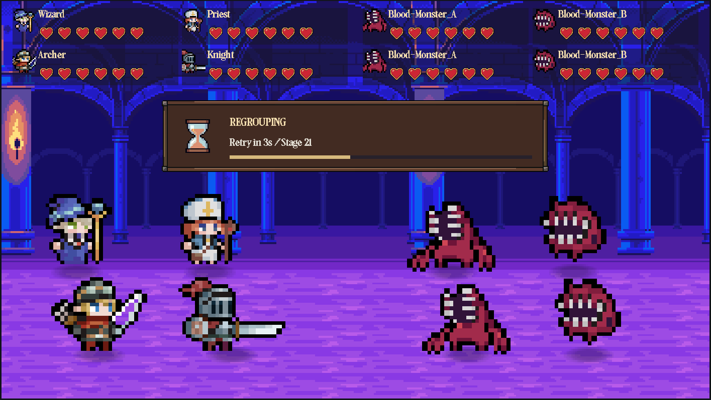
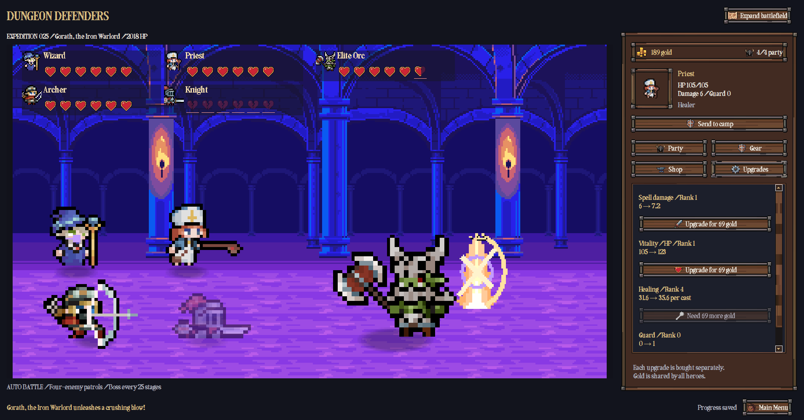
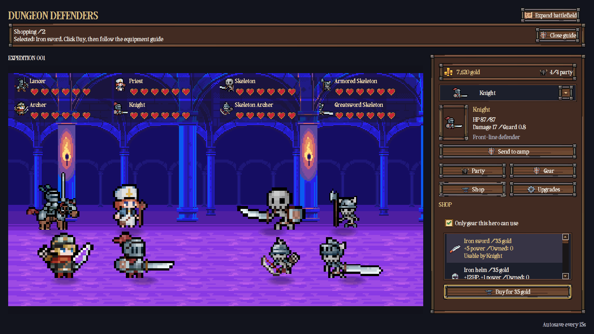
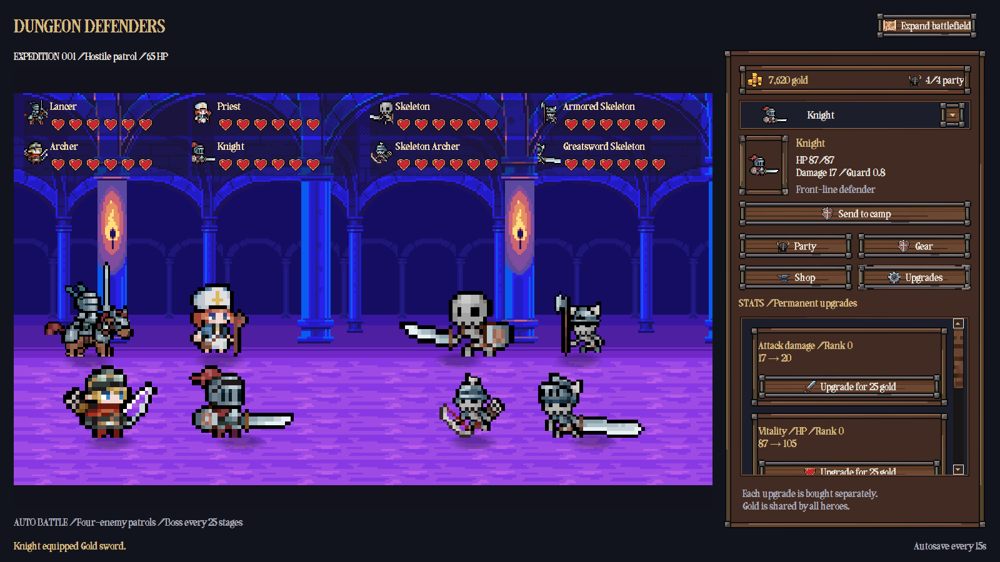

# Dungeon Defenders

**Current version: V1.5 (1.5.0)** — the equipment, audio, and camp recovery update. See the [changelog](CHANGELOG.md) for V1.5 changes and the original V1 baseline.

A medieval dark-fantasy idle RPG built with **Java, Swing, and Java2D**. Assemble a party of four, battle through a haunted corridor, and spend your rewards on the upgrades and equipment needed to reach the next stage.

Combat runs automatically. You choose who fights, how they grow, and what they carry.

## What's new in 1.5.0

All updates below belong to **1.5.0**, from equipment icons through audio, camp recovery, and guides.

| Update | What changed |
| --- | --- |
| **Equipment artwork** | 27 Raven icons in Shop, Gear, and inventory choices, with Iron, Gold, and Crystal tiers offering increasing bonuses and prices |
| **Shop-only gear** | Buy all new equipment with gold. New campaigns start with 120 gold and empty equipment slots. Victories award gold only, and existing saved equipment is retained |
| **Combat audio** | Role-based attack, impact, and healing sounds for all nine heroes, plus attack cues for all 33 enemy types and feedback sounds for victories and management actions |
| **Music and ambience** | Generated dungeon/menu and boss themes, crossfades, crypt ambience, and saved music and effects volume controls |
| **Camp recovery** | Downed heroes leave the party and heal at camp over 30 seconds, including offline time. Recruits and recovered heroes must be added manually |
| **Action guides** | Closable instructions and golden button highlights help with recruiting, buying, deploying, and equipping. Recovery notices and countdowns explain when heroes are ready |
| **Save compatibility** | Camp timers and empty parties are saved. Older save formats remain supported, with the game version unchanged at 1.5.0 |
| **Named expeditions** | Play opens a themed campaign library. Create separate named games, resume a chosen save, or use its left-side options button to rename or delete it |

Weapon restrictions still apply, and equipped gear changes stats rather than character artwork. Creature sounds use shared effects where dedicated recordings are unavailable. See [Audio](#audio) and the [changelog](CHANGELOG.md) for details.

## Current features

- **Nine recruitable classes** with melee, ranged, magic, and healing roles
- **Four-enemy patrols** grouped by species, with a boss every 25 stages
- **Separate upgrades** for attack or spell damage, maximum HP, healing, and guard
- **Shop-only equipment** with class-specific weapons, hats, armor, and shoes. New campaigns start with empty equipment slots
- **Animated pixel art** with character actions, targeted combat effects, heart indicators, and scrolling scenery
- **Audio** with role-based combat effects, creature-family cues, dungeon music, boss music, and separate volume controls
- **Persistent progress** with automatic saving and up to eight hours of offline gold
- **Camp recovery** sends downed heroes to camp for 30 seconds, freeing party slots without losing gold, gear, or stage progress
- **Dismissible guides** highlight recruitment, shopping, deployment, and equipment steps

## Screenshots

Earlier V1 gameplay screenshots, with additional previews of the management tabs. Some images show the old equipment icons, starter gear, or a "Found" reward message. The current build uses Raven equipment icons and shop-only equipment, with gold-only victory rewards. Select an image to view it at full size.

### Main menu

This older screenshot shows the former separate continue/new buttons. The current menu has one **Play** button that opens the expedition library, alongside Settings, Credits, and Quit Game.



### Battlefield and party

Manage a four-member party while battles run automatically. The sidebar keeps your gold, selected hero, and management tabs together.



<details>
<summary>Combat and health indicators</summary>

Melee strikes and spells land on their targets, while hearts show each combatant's remaining health.



</details>

<details>
<summary>Regrouping after defeat</summary>

This older screenshot shows the regrouping notice. In the current build, downed heroes recover at camp for 30 seconds and must be added back manually. Gold, equipment, and progress are preserved.



</details>

<details>
<summary>Boss encounters and upgrades</summary>

Every 25 stages introduces a boss. Upgrade individual stats to help the party push further, including stronger priest healing.



</details>

<details>
<summary>Gear tab</summary>

Manage the selected hero's weapon, hat, armor, and shoes. Equip compatible items from the shared stash.


</details>

<details>
<summary>Shop tab</summary>

Compare equipment prices, stats, and class requirements before spending gold.



</details>

<details>
<summary>Upgrades tab</summary>

Review current and next stats, then purchase separate damage, vitality, healing, or guard upgrades.



</details>

## Before you run

You need **JDK 11 or newer** and the required assets installed locally. The game uses standard Java libraries and does not require Maven or Gradle.

**Asset packs are not included in this repository.** The project uses paid character packs, and raw third-party artwork, fonts, source archives, and asset-sheet previews are excluded from Git. Only the composed game screenshots shown above are included for documentation. Obtain the assets from their creators using the links below, then follow the [local asset setup guide](assets/README.md).

A fresh clone contains the source code, but the complete GUI and asset-dependent tests require the local packs. In particular, missing required UI images prevent the interface from loading.

## Run the game

From the folder containing this repository, open PowerShell and run:

```powershell
cd JAVA_DungeonDefenders
.\run.cmd
```

If your terminal is already inside `JAVA_DungeonDefenders`, run only `.\run.cmd`.

The launcher compiles the source into `out/` and starts the game. It uses `JAVA_HOME` when set, otherwise `javac` and `java` must be available on `PATH`. Launchers resolve their own folder, so they also work when called by their full path.

To compile and launch manually from the project folder:

```powershell
New-Item -ItemType Directory -Force out
javac --release 11 -d out src\idle\*.java
java -cp out idle.IdleGame
```

## Playing

Choose **Play** to open your expedition library. Each framed save card shows its name, stage, gold, and active party count. Press its **Play** button to resume and collect offline gold, or **New Expedition** to create a separate campaign with a unique name of 1–32 characters. New expeditions begin with a Knight, Wizard, Priest, and Archer, plus 120 gold and empty equipment slots. Heroes can fight without equipment. Existing saves retain previously owned gear.

The gear-shaped options button on the **left of each save card** offers **Rename** and **Delete**. Renaming changes only the display name and preserves offline time. Deleting asks for confirmation and permanently removes that selected save. Creating a campaign never overwrites another. Your original `ashen-save.properties` appears as **Existing Expedition** until renamed.

Use the management panel beside the battlefield:

| Tab | What to do |
| --- | --- |
| **Party** | Select a hero, recruit another class, or swap members between camp and your active party |
| **Upgrades** | Improve the selected hero's damage, vitality, guard, or priest healing |
| **Shop** | Spend gold on equipment for the shared stash |
| **Gear** | Equip compatible items or return equipped items to the stash |

Up to four heroes can fight at once. Manual camp transfers keep at least one fighter, but automatic rescue can empty the party and pause combat. Upgrade previews show the next improvement and its cost. Equipment changes stats, but does not change the character's sprite.

**Expand battlefield** hides the management panel. **Show party & gear** brings it back. Settings include reduced motion, damage/healing number controls, and separate music and effects/ambience volume sliders. Set a slider to zero to mute that channel.

### Classes and equipment

Each hero has four equipment slots: **weapon, hat, armor, and shoes**. Hats, armor, and shoes can be worn by every class.

| Class | Weapons | Role |
| --- | --- | --- |
| Lancer | Spear | Melee damage |
| Wizard | Staff, wand | Magic damage |
| Priest | Staff, wand | Healing and supporting attacks |
| Archer | Bow | Ranged damage |
| Soldier | Spear | Melee damage |
| Knight | Sword | Front-line guard |
| Knight Templar | Sword | Front-line guard |
| Swordsman | Sword | Melee damage |
| Armored Axeman | Axe | Melee damage |

Equipment uses **Iron (tier 1), Gold (tier 2), and Crystal (tier 3)** artwork. Higher tiers cost more and grant stronger bonuses. Selected icons from **Free - Raven Fantasy Icons** appear in the Shop, Gear slots, and inventory choices. Character sprites retain their original built-in weapons and clothing.

### Progression and recovery

Enemy health and damage increase with the stage. Normal patrols contain four enemies of the same species, while every 25th stage introduces a boss. Patrol and boss victories award gold only. All equipment must be purchased from the Shop.

A downed hero is automatically sent to camp and frees a party slot. Camp recovery takes **30 seconds**, gradually restores HP, and continues while the game is closed. Injured heroes you manually send to camp also recover there. Recovering heroes cannot be deployed until their countdown finishes.

Recruits and recovered heroes stay at camp until you select them in **Party** and choose **Add to party**. If all four slots are occupied, send someone else to camp first. Surviving party members keep fighting. If the entire party falls, enemies reset to full HP and combat pauses on the same stage until you deploy a ready hero. No gold, equipment, or stage progress is lost.

Closable guide cards explain recruitment and purchases, with golden highlights on the next useful controls. Buying equipment never equips it automatically. Close a guide to remove its highlights. Camp notices announce rescues and completed recovery, and roster cards show the remaining seconds.

Offline rewards provide gold for up to eight hours away. They do not advance stages or award equipment.

## Audio

The NimbeKit pack supplies combat, spell, healing, interface, and dungeon ambience effects. Cues follow the animation timing, with repeated hits limited to keep battles from becoming too loud. Menu Settings saves independent music and effects/ambience volume levels.

The pack contains **sound effects and ambience, not music tracks**. Two original procedural loops provide a consistent dungeon/menu theme and a faster boss theme. Music crossfades when the visible encounter changes, including when continuing a saved boss stage, and returns to the dungeon theme after the boss death transition. All bosses currently share one boss theme.

All nine heroes and thirty-three enemies have attack sound mappings. Shared effects stand in for dedicated creature recordings. See the [audio coverage and limitations](assets/README.md#audio) for the species mapping and missing unique sounds. Character artwork retains its weapons even with empty equipment slots, so attacks still use the class's weapon sound.

Audio files are kept locally under `assets/packs/NimbeKit_Fantasy_RPG_SFX_160/`. Missing files or unavailable audio devices do not stop the game. Audio decoding and trigger tests run silently with `run.cmd test`.

## Asset credits and sources

The artwork, equipment icons, font, sound effects, and ambience come from the following sources. They are obtained separately and are not redistributed with this repository. Music is generated by the game rather than supplied by these packs.

| Used for | Asset | Creator / source |
| --- | --- | --- |
| Characters and enemies | [Tiny RPG Character Asset Pack 01 V2.0](https://zerie.itch.io/tiny-rpg-character-asset-pack) | Zerie |
| Characters and enemies | [Tiny RPG Character Asset Pack 02](https://zerie.itch.io/tiny-rpg-character-asset-pack-02) | Zerie |
| Background | [Gothicvania Cold Corridors](https://ansimuz.itch.io/gothicvania-cold-corridors) | Ansimuz |
| User interface | [Free Medieval Fantasy UI Pack](https://kibyra.itch.io/free-medieval-fantasy-ui-pack) | Kibyra |
| Equipment icons | [Raven Fantasy Icons](https://clockworkraven.itch.io/raven-fantasy-icons) | Clockwork Raven |
| Sound effects and ambience | [Fantasy RPG: Dungeon & Magic SFX Pack](https://nimbekit.itch.io/fantasy-rpg-dungeon-magic-sfx-pack) | NimbeKit |
| Font | [Pixelta](https://www.dafont.com/pixelta.font) | DaFont listing |

The character mappings use the **full 22-character and 20-character packs**. The free sample versions do not cover the complete roster. Consult each creator's asset page and included license for usage terms.

See [assets/README.md](assets/README.md) for folder names, animation integration, and custom sprite overrides.

## Saves and local files

Progress is saved automatically every 15 seconds, after purchases and party changes, and when the game closes normally.

| File | Purpose |
| --- | --- |
| `ashen-save.properties` | Original campaign, still selectable in the expedition library |
| `saves/*.properties` | Separate named campaigns, using generated filenames independent of their display names |
| `ashen-save-backup-*.properties` | Backups made before replacing an existing campaign |
| `settings.properties` | Display, animation, music volume, and effects/ambience volume preferences |
| `out/` | Compiled classes and generated test previews |

The game remains **V1.5 (1.5.0)**. The internal save-format number is separate from the game version. Save format 4 preserves camp recovery timers and supports empty parties. Older save formats 1–3 still load. Recovered heroes are never automatically redeployed.

The `ashen-` save names are retained for compatibility with earlier versions of the project. Keep them with the game when renaming its folder. These local files are excluded from Git.

To start over without losing progress, choose **Play → New Expedition**. Use a save card's options to delete an unwanted campaign. Keep both `saves/` and any original `ashen-save.properties` when moving or backing up the game. The entire `saves/` folder is excluded from Git. The older `save.properties` format is not imported.

## Future updates

V1.5 builds on the original V1 gameplay with equipment icons, audio, camp recovery, and action guides. The following are potential improvements for later versions, with priorities subject to change. They are not yet implemented or assigned to a release.

### Fixes and polish

- Refine movement, attack timing, and transitions to reduce abrupt animation changes
- Improve text spacing, readability, and panel layouts across window sizes and display scaling
- Tune enemy scaling, boss difficulty, upgrade costs, and gold rewards
- Expand checks for save recovery, offline rewards, and longer play sessions

### Possible features

- Give enemies and bosses distinct skills and attack patterns
- Add more equipment variety and clearer item comparisons
- Expand equipment artwork and explore visible gear changes on character sprites. Selected Raven icons are now used in the Shop and Gear tabs
- Introduce additional environments and encounter variety
- Expand the soundtrack and add dedicated creature voices and death sounds
- Improve missing-asset messages and setup guidance for new players

Completed changes will be recorded in the [changelog](CHANGELOG.md), keeping the V1 feature baseline available for reference.

## Development

| Source file | Responsibility |
| --- | --- |
| `Catalog.java` | Classes, weapons, gear, and enemy definitions |
| `GameState.java` | Combat, upgrades, inventory, rewards, and progression |
| `Encounters.java` | Patrol composition, bosses, and creature sizes |
| `SaveStore.java` | Save validation, migration, and file locking |
| `CampaignLibrary.java` | Named campaign discovery, creation, renaming, and deletion |
| `AssetPack.java` | Animation sheets and background layers |
| `PixelArt.java` | Sprite overrides, portraits, and placeholder art |
| `GameAudio.java` | WAV playback, sound mappings, generated music, volume, and audio lifecycle |
| `BattlePanel.java` | Battlefield rendering and combat animation |
| `IdleGame.java` | Main window and party management |
| `MainMenu.java` | Menu, settings, and campaign selection |
| `UiSkin.java` | Font, frames, icons, and interface controls |

Source files are in `src/idle/`, and tests are in `tests/idle/`.

With the local assets installed, run:

```powershell
.\run.cmd test
```

Checks cover combat, upgrades, equipment, encounters, save migration, offline rewards, camp recovery, manual deployment, guide dismissal, audio mappings and timing, asset loading, and rendering. Generated previews are written to `out/`.
